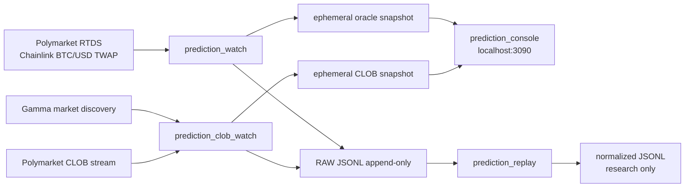

# Handoff — Quant Settlement Intelligence

**Fecha:** 2026-09-18  
**Estado:** fases 0–2 aprobadas e iniciadas: captura y replay *read-only*.  
**Siguiente sesión:** leer este relevo, el plan y el contrato de captura antes de ampliar fuentes o construir modelos.

## Resultado actual

Hay un proyecto Rust funcional, **Nakamotito Prediction**, con consola en `http://127.0.0.1:3090`. Observa dos fuentes de Polymarket:

1. **RTDS / Chainlink:** BTC/USD TWAP de referencia de settlement.
2. **Gamma + CLOB:** contrato BTC Up/Down activo, su configuración de resolución y mejor bid/ask de `Up` y `Down`.

No es aún un predictor ni un bot. No contiene wallet, credenciales, órdenes, paper trading o ejecución; sólo `WATCH` / `NO_TRADE` en el diseño futuro.

## Qué hace la interfaz

| Bloque | Información | Interpretación correcta |
| --- | --- | --- |
| Settlement reference | Último BTC/USD TWAP recibido por RTDS | Referencia de oracle, no precio negociable ni señal. |
| Current contract / time to close | Mercado Up/Down y ventana contractual obtenida de Gamma | Contexto de la ronda observada. |
| Oracle feed | Relojes RTDS/local, E18, baseline de ronda | Diagnóstico de frescura y auditabilidad. |
| Round baseline | Primer TWAP visto hasta 5 s después del inicio | Sólo investigación; si llegó tarde queda `MISSED_START_TWAP`, nunca se inventa apertura. |
| Current vs baseline | Diferencia actual en bps contra la baseline | Contexto, no recomendación direccional. |
| CLOB / outcome book | Fuente de settlement, TWAP, mejor bid/ask, spread | Snapshot de top-of-book, no profundidad L2 ni edge. |
| Health | Edad, reconexiones y errores | Datos stale deben rechazarse en investigación futura. |

## Arquitectura implementada



Rust recibe datos y mantiene el camino rápido. La captura RAW conserva mensaje original y relojes locales; el replay produce una copia normalizada sin modificar RAW. Python queda para investigación offline futura, nunca para recepción o decisiones route-critical.

## Mapa de archivos

| Ruta | Responsabilidad |
| --- | --- |
| `src/bin/prediction_console.rs` | Axum local, API y ciclo de vida de watchers. |
| `src/console.html` | Consola local. |
| `src/bin/prediction_watch.rs` | RTDS Chainlink, snapshot y baseline. |
| `src/bin/prediction_clob_watch.rs` | Gamma y CLOB. |
| `src/research.rs` | RAW JSONL, clocks, normalización y replay. |
| `src/bin/prediction_replay.rs` | Replay offline. |
| `docs/RESEARCH-CAPTURE-CONTRACT.md` | Esquemas y semántica de captura. |
| `docs/QUANT-SETTLEMENT-PLAN-2026-09-18.md` | Plan, fases, diagramas, features y validación. |

## Operación

```bash
cargo run --release --bin prediction_console
```

Abrir `http://127.0.0.1:3090` y usar **Start watchers**. El console lanza ambos watchers como hijos directos; **Stop** los termina sin procesos huérfanos.

Opciones de ruta:

```bash
PREDICTION_DATA_DIR=/ruta/a/datos cargo run --release --bin prediction_console
PREDICTION_STATE_DIR=/ruta/a/snapshots cargo run --release --bin prediction_console
```

Por defecto los snapshots efímeros viven en `prediction-state/` y el RAW en `prediction-data/`; ambos están ignorados por Git. **Stop** borra snapshots, pero conserva investigación RAW. `Ctrl-C` apaga servidor e hijos.

Captura/replay directo:

```bash
cargo run --release --bin prediction_watch -- --record prediction-data
cargo run --release --bin prediction_clob_watch -- --record prediction-data
cargo run --release --bin prediction_replay -- \
  --input prediction-data/raw/<sesion>/events.jsonl \
  --out prediction-data/normalized/<sesion>.jsonl
```

Una sesión crea `raw/<timestamp>-<source>/manifest.json` y `events.jsonl`. RAW es append-only; cada evento lleva `received_at_ms`, `processed_at_ms`, tipo y payload original. Replay no toca RAW.

## Verificación ya hecha

- `cargo test`: 8 pruebas pasan (RAW/clocks, normalización, baseline y Gamma).
- `cargo build --bins`: todos los binarios compilan.
- `git diff --check`: sin errores de whitespace en estos cambios.
- Pruebas locales cortas confirmaron captura de RTDS y miles de eventos CLOB en JSONL. Medir disco antes de una campaña prolongada.

`rustfmt` no está instalado en el toolchain actual. Antes de un PR, ejecutar `cargo fmt` donde esté disponible.

## Límites importantes

1. El target contractual es Chainlink TWAP; spot/perp futuros son features, no sustituto del target.
2. La baseline observada no demuestra fórmula final de settlement ni sustituye el dato oficial de cierre.
3. Aún no existe libro L2 incremental: no usar imbalance/microestructura como feature.
4. No existen todavía Binance, Bybit, Deribit, opciones, liquidaciones, sentiment, `q(t)` ni entrenamiento.
5. `GEX` es una estimación de régimen con supuestos; no es inventario de dealers observado.
6. Retención actual: hasta borrado administrado por el usuario. Falta política de capacidad, compresión y particionado.
7. `docs/ARCHITECTURE.md`, `docs/HANDOFF-2026-09-09.md` y `docs/KNOWLEDGE_GRAPH.md` ya estaban modificados antes de este trabajo: preservarlos y revisarlos antes de mezclarlos.

## Orden preciso de construcción

1. **Contrato de calidad:** definir `normalized-event-v1` interfuente (identidad, clocks, latencia, secuencia, calidad y razón de rechazo), siempre trazable a RAW.
2. **CLOB L2:** snapshot inicial, deltas, secuencia, gaps, resync y replay determinista. Ésta es la prioridad recomendada.
3. **Registry/labels:** persistir por contrato ventana, regla TWAP, referencias y label final; si falta evidencia, `unresolved`/`invalid`, nunca inferir.
4. **Multi-venue mínimo:** collectors separados de Binance spot/perp y Bybit spot/perp, con RAW, normalización y calidad propios. Compartir ideas con Nakamotito Trading, no su runtime/WAL/UI/ejecución.
5. **Features offline:** distancia al TWAP/tiempo restante, retornos-volatilidad, book metrics ya validadas y lead-lag. Separar `Ĉ(t)` (nowcast settlement), `q(t)` (probabilidad) y precio CLOB (consenso negociable).
6. **Validación/modelos:** baselines calibrados, walk-forward con purge/embargo y costos. Opciones, OI/IV y sentiment llegan después como contexto/régimen.

## Aprobaciones pendientes

Hace falta decisión explícita sobre duración/ubicación de campaña de datos, presupuesto de almacenamiento, venues/políticas de uso, definición exacta de label, promoción a shadow/paper y cualquier wallet/orden/ejecución. Lo último sigue fuera de alcance.

## Checklist para otra sesión

- [ ] Leer este relevo, el plan y el contrato de captura.
- [ ] Revisar `git status` y preservar los tres documentos sucios preexistentes.
- [ ] Fijar presupuesto y duración de captura RAW.
- [ ] Implementar CLOB L2 antes de integrar nuevos venues.
- [ ] Diseñar `normalized-event-v1` antes de Binance/Bybit.
- [ ] Reproducir una sesión con replay y tests antes de añadir una fuente.
- [ ] No generar señal direccional hasta tener labels y validación temporal.

## Enlaces

- [Plan Quant Settlement Intelligence](QUANT-SETTLEMENT-PLAN-2026-09-18.md)
- [Contrato de captura y replay](RESEARCH-CAPTURE-CONTRACT.md)
- [Decisión compartida](../../nakamotito-knowledge/07-Decisiones/Decision-Plan-Quant-Prediction-2026-09-18.md)
