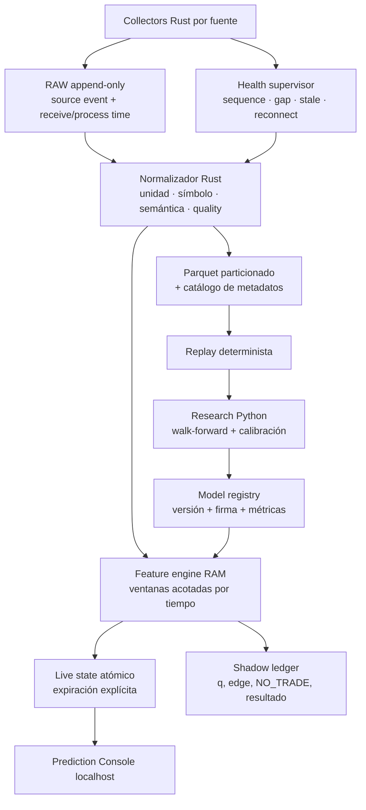
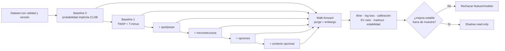
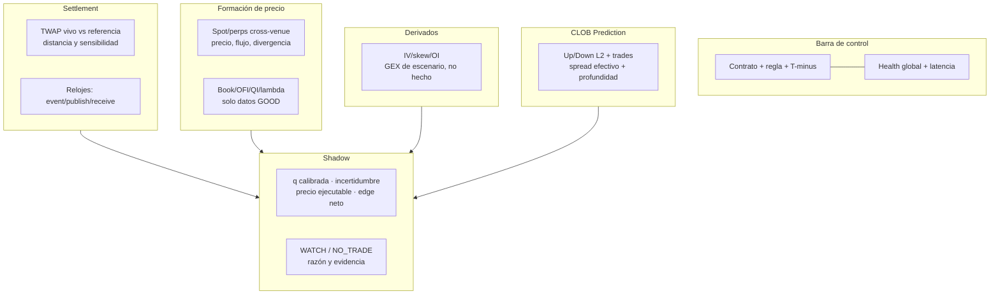

# Plan para aprobación — Quant Settlement Intelligence

**Estado:** aprobado para fases 0–2 de investigación read-only el 2026-09-18; no autoriza
entrenamiento, paper trading ni ejecución.  
**Producto:** Nakamotito Prediction Console, aplicación independiente de Nakamotito Trading.  
**Primer universo:** BTC Up/Down de Polymarket a 5 minutos, extendible por registry a otros
contratos y activos.

## Decisión aprobada

Aprobada una fase de investigación cuantitativa read-only con persistencia de investigación
versionada. Su finalidad es comprobar o rechazar la siguiente hipótesis:

> Condicionado a la regla de resolución, al estado observable del oracle, al tiempo restante y a
> variables de microestructura multi-venue, existe una estimación calibrada de la probabilidad de
> resolución que mejora de forma estable el precio ejecutable del CLOB después de costes.

No se presupone alpha. `NO_TRADE` es un resultado correcto. Ninguna fase habilita wallet,
credenciales, orden, firma, simulación de orden contra un venue ni integración con Trading.

## 1. El problema cuantitativo exacto

Para cada contrato se registra la regla específica. Para la familia inicial, el target no es el
último tick spot:

```text
Y = 1  si TWAP_Chainlink(fin de la ronda) >= referencia_Chainlink(inicio de la ronda)
    0  en otro caso
```

Polymarket indica para sus mercados BTC Up/Down que la fuente es el stream BTC/USD TWAP de
Chainlink y que el resultado depende del TWAP de la franja indicada, no de otro spot. Cada ronda
debe leer y conservar su regla/configuración; una constante global no sustituye el contrato.

Se separan dos modelos:

- **Nowcast del settlement `Ĉ(t)`:** estimación del reporte Chainlink que se observará al cierre.
- **Forecast `q(t) = P(Y=1 | G(t))`:** probabilidad calibrada de `Up`, condicionada al estado
  global observable `G(t)`.

`q(t)` no es una orden. La política posterior compara `q(t)` con **bid/ask ejecutable**, fees,
slippage, fill probability, latencia e incertidumbre.

## 2. Arquitectura de información

```mermaid
flowchart LR
  subgraph S[Formación de precio]
    SP[Spot CEX\ntrades + L2]
    PP[Perps CEX\ntrades + L2 + funding/OI]
    OP[Opciones\nOI + IV + griegas + libros]
    OC[On-chain / DEX\nsolo si aporta señal medible]
  end
  subgraph R[Resolución]
    CR[Registry de contrato\nregla · ventanas · fees · outcome]
    CL[Chainlink TWAP\nevent/publish/receive clocks]
  end
  subgraph M[Prediction market]
    GM[Gamma discovery\nround + metadata]
    PM[Polymarket CLOB\nL2 + trades + spread + fills observados]
  end
  S --> G[Global Market State G(t)]
  CR --> G
  CL --> G
  GM --> G
  PM --> G
  G --> C[Nowcast Ĉ(t)\ndel settlement]
  G --> Q[Forecast q(t)\nP de resolución Up]
  C --> Q
  Q --> D[Evaluador de edge neto\nWATCH / NO_TRADE]
```

Los cuatro planos no se colapsan: spot/perps forman precio; Chainlink es oracle; el mecanismo del
contrato entrega/resuelve; Polymarket es el mercado de probabilidad. Que Chainlink esté disponible
en muchas redes pertenece al plano de entrega, no revela qué exchanges compone internamente el
feed.

## 3. Runtime: latencia, calidad y datos reproducibles

Rust es la ruta crítica: recepción WebSocket, normalización, reloj común, feature engine y
snapshots. Python queda para investigación offline, entrenamiento y evaluación; no participa en la
decisión en vivo. La UI solo consume estado precomputado: no bloquea ni retrasa los collectors.



### Relojes obligatorios

Cada evento debe conservar `event_time`, `publish_time` si existe, `receive_time`,
`process_time`, secuencia/offset cuando exista, y `clock_quality`. Ninguna fila atrasada o con gap
puede hacerse pasar por contemporánea. La latencia se mide por tramo, no como un único número.

### Política de calidad

| Estado | Significado | Uso en modelo |
|---|---|---|
| `GOOD` | Cobertura, secuencia y frescura válidas | Elegible |
| `DEGRADED` | Fuente parcial, retrasada o con incertidumbre | Feature explícita; por defecto `NO_TRADE` |
| `INVALID` | Gap, secuencia rota o semántica desconocida | Excluir de features/labels |
| `ABSENT` | No llegó o no aplica | `null`, nunca cero |

## 4. Matriz de fuentes y orden de incorporación

El orden reduce complejidad y favorece evidencia útil. Una fuente declarada no se promueve hasta
tener contrato, fixtures, normalización, replay, cobertura y prueba de contribución incremental.

| Cohorte | Fuentes | Datos mínimos | Función |
|---|---|---|---|
| A — settlement | Chainlink TWAP + Gamma + CLOB | regla, TWAP, L2, trades, cierre, fees | Target y benchmark del mercado |
| B — precio | Binance + Bybit, spot/perp BTC | trades, L2, mark/index, funding, OI | Lead-lag y microestructura primaria |
| C — extensión | OKX/BingX/Hyperliquid, tras puerta técnica | mismo contrato y calidad que B | Diversificación medida, no promedio ciego |
| D — opciones | Deribit primero; Binance/Bybit si superan contrato | OI, IV, griegas, strikes, expiries, libros | Régimen de volatilidad y cobertura estimada |
| E — contextual | liquidaciones, DEX/on-chain, noticias/sentimiento | timestamp y semántica verificables | Solo si mejora holdout |

No se asume que más venues produzcan mejor modelo: cada uno compite contra el baseline mediante
ablación temporal y coste computacional.

## 5. Features: qué se calcula y qué significa

```mermaid
flowchart LR
  T[TWAP state\ndistancia · pendiente · ventana · T-minus] --> Q[q(t)]
  B[Book/L2\nOFI · QI · depth · spread · cancel/replenish] --> Q
  F[Trade flow\nagresor · CVD · intensidad · VPIN · lambda] --> Q
  V[Cross-venue\ndivergencia · sincronía · lead-lag · basis/funding] --> Q
  O[Options regime\nIV/skew · OI · GEX escenario · expiry proximity] --> Q
  P[Prediction CLOB\nprob implícita · microestructura Up/Down] --> Q
  X[Contexto\nliquidaciones · noticias] --> Q
```

### 5.1 Settlement y ventana TWAP

- referencia de apertura, TWAP actual y distancia al umbral en bps;
- pendientes/curvatura del TWAP, retornos y volatilidad por horizontes;
- segundos restantes, porción de la ventana TWAP ya observada y sensibilidad teórica del
  promedio a un movimiento restante;
- diferencias entre reloj Chainlink, publicación y recepción.

### 5.2 Microestructura de spot y perps

- OFI, queue imbalance y queue flips; profundidad y slope del L2;
- flujo agresor firmado, CVD, trade intensity, tamaño/distribución de trades;
- spread, resiliencia/replenishment, Kyle lambda, Amihud y toxicidad;
- mark/index, basis, funding, OI y liquidaciones;
- lead-lag por venue/instrumento sin sumar libros ni CVD de fuentes no alineadas.

### 5.3 Opciones y griegas

Las opciones son un **factor de régimen**, no una entrada autónoma. Se calculan IV ATM, skew,
term structure, OI por strike/expiry, expected move, delta/gamma/vega por contrato y exposiciones
por escenarios. `GEX_estimated` conserva fórmula, convención, multiplicador, supuestos de signo,
timestamp y calidad.

No se publica `dealer_position_observed`: OI no revela quién está largo/corto ni el hedge real del
dealer. Gamma puede amortiguar o amplificar movimientos según inventario y cobertura; el modelo
debe demostrar valor incremental frente a microestructura y settlement, especialmente alrededor
de expiraciones o zonas ATM relevantes.

### 5.4 CLOB de Prediction

Además del mejor bid/ask actual, se requieren deltas L2, trades, profundidad por nivel, spread
efectivo, cancelación/replenishment y edad de quote. La dirección de trades será `unknown` cuando
no pueda inferirse de forma defendible. El target de este plano es detectar cuánto tarda el CLOB en
incorporar información ya observable, no confundir su propio precio con el settlement.

## 6. Laboratorio: diseño contra autoengaño



### Labels y evaluación

- label primario: resultado de resolución verificado;
- snapshots de decisión por `T-minus` (por ejemplo 300, 180, 120, 60, 30 y 10 s), con la
  información que realmente existía en ese instante;
- benchmarks: probabilidad implícita CLOB, settlement state solo y modelos por ablación;
- splits walk-forward con purge y embargo: las rondas y las ventanas TWAP comparten información;
  no se permite un split aleatorio de filas;
- métricas: Brier, log loss, calibration curve, AUC como secundaria, EV neto, fill rate,
  markout, capacidad y cobertura de `NO_TRADE`;
- reportes por régimen, horario, distancia al umbral, calidad, liquidez y `T-minus`.

Una mejora de accuracy sin calibración ni edge neto se rechaza. Una mejora de PnL in-sample sin
estabilidad temporal se rechaza.

## 7. Política de decisión en shadow mode

```text
edge_buy_up = q(t) - ask_up - fees - slippage - impacto - buffer_incertidumbre
edge_buy_down = (1 - q(t)) - ask_down - fees - slippage - impacto - buffer_incertidumbre
```

La salida inicial solo puede ser `WATCH` o `NO_TRADE`. Un candidato de edge debe pasar:

1. contrato y ronda válidos;
2. settlement, CLOB y cohortes mínimas en `GOOD`;
3. modelo y features cubiertos por la ventana completa;
4. edge neto positivo con buffer conservador;
5. liquidez/capacidad y fill probability aceptables;
6. registro trazable de inputs, versión, decisión hipotética y resultado.

No se conecta ningún router de órdenes en este plan. Una propuesta futura de paper trading o
ejecución será un documento distinto y requerirá aprobación explícita.

## 8. Interfaz en tiempo real



La UI tiene tres modos de lectura: **operación** (frescura/ronda), **microestructura**
(fuentes y divergencias) y **laboratorio** (calibración/ablación/replay). Nunca presenta una
estimación como certeza: muestra dato observado, derivado, inferido e hipótesis con etiquetas
distintas.

## 9. Fases, entregables y puertas de paso

| Fase | Entregable verificable | Puerta para pasar |
|---|---|---|
| 0 — contrato | Registry de mercados y schemas de eventos/labels | Regla, clocks, fees y outcomes verificables |
| 1 — captura | RAW persistente, health y catálogo de sesiones | Cobertura continua, replay y retención aprobada |
| 2 — normalización | Eventos canónicos y feature store reproducible | Fixtures, secuencias/gaps y tests por fuente |
| 3 — cohortes A/B | Chainlink+CLOB+Binance+Bybit sincronizados | Lead-lag descriptivo sin leakage; sesiones limpias |
| 4 — laboratorio base | Baselines de CLOB y TWAP/T-minus | Walk-forward, purge/embargo, informe negativo/positivo |
| 5 — microestructura | Ablación de book/flow/cross-venue | Mejora estable fuera de muestra o rechazo explícito |
| 6 — opciones | IV/OI/griegas/GEX por escenarios | Valor incremental y calidad; sin atribuir inventario real |
| 7 — shadow | Ledger de `q`, edge y resultado | Calibración, coste y estabilidad auditables |
| 8 — evaluación | Documento de promoción o descarte | Aprobación independiente; ejecución sigue apagada |

## 10. Alcance, límites y decisiones pendientes

### Incluido en la aprobación actual

- Persistencia local de investigación con retención, hashes, schemas y replay.
- Conectores públicos read-only y cálculo local en Rust.
- Modelado offline, validación temporal y shadow dashboard.
- Documentación de fuente, calidad, licencia/ToS y atribución de cada variable.

### Excluido

- Wallets, claves privadas, firmas, órdenes, ejecución, copy trading o evasión geográfica.
- Mezclar runtime, estado, WAL, estrategias o UI de Nakamotito Trading.
- Llamar “dealer flow observado” a GEX estimado.
- Tratar sentimiento, una red Chainlink o un venue como prueba de causalidad/edge.

### Aprobaciones explícitas pendientes

1. Retención y presupuesto de almacenamiento del dataset RAW/normalizado.
2. Lista inicial de venues y sus límites de frecuencia/condiciones de uso.
3. Duración mínima de captura antes del primer estudio formal.
4. Definición del umbral de promoción a shadow; no incluye ejecución.

## Resultado esperado de la primera etapa

No es un bot. Es una respuesta defendible a tres preguntas:

1. ¿Qué fuentes llegan suficientemente pronto, completas y sincronizadas para describir el
   settlement de este contrato?
2. ¿Qué features —si alguna— mejoran la probabilidad calibrada frente al CLOB por sí solo?
3. ¿Queda edge neto tras costes, latencia, fill risk y validación temporal?

Si la respuesta a la tercera es no, el plan habrá funcionado: habrá evitado construir ejecución
sobre una hipótesis no demostrada.

## Referencias de diseño

- [Polymarket — ejemplo de regla BTC Up/Down con Chainlink TWAP](https://polymarket.com/event/btc-updown-5m-1789745700?outcomeIndex=0)
- [Arquitectura canónica de settlement multi-venue](../../nakamotito-knowledge/02-Arquitectura/Oracle-y-Settlement-Intelligence-Multi-Venue.md)
- [Límite epistemológico de GEX/dealer hedging](../../nakamotito-knowledge/13-Opciones/GEX-Estimado-y-Dealer-Hedging.md)
- [Walk-forward, purge y embargo](../../nakamotito-knowledge/11-Quant-y-Estadistica/Walk-Forward-Purge-Embargo.md)
- [Estudio de expiración BTC y gamma](https://www.sciencedirect.com/science/article/pii/S1544612326008688)
